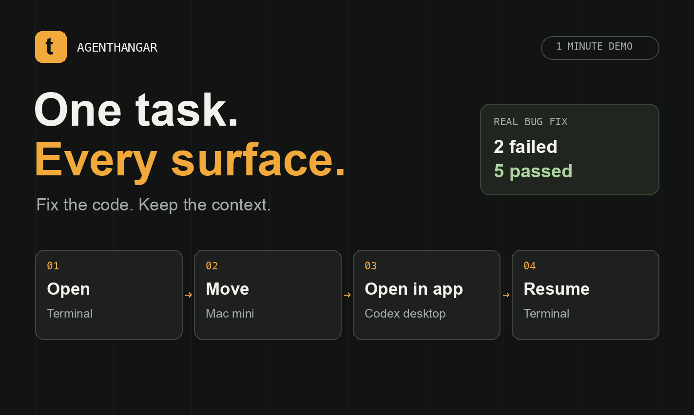

# agenthangar.github.io

Organization site for [AgentHangar](https://github.com/agenthangar). Static HTML, CSS, and JavaScript with no build step.

- `index.html` — the page
- `styles.css` — styles
- `assets/favicon.svg` — favicon (monogram on a dark tile)
- `assets/avatar.svg` — 512px square version for the GitHub org avatar
- `assets/logo.svg` — bare monogram

## Analytics

The website uses Google Analytics 4 through the Google tag in `index.html`.
The AgentHangar account contains the **AgentHangar Website** property and web
stream for `https://agenthangar.ai`, with measurement ID `G-JYN4WLH0XT`.
Enhanced measurement collects page views, scrolls, and outbound link clicks
(including the destination repository URL). These events are automatic; avoid
adding a second tag or manual page-view/click events that would duplicate them.

To verify an installation, use the stream's **Test installation** tool and check
**Realtime** or **DebugView** while visiting the site and clicking a project link.

## Publishing

Push this repository to `agenthangar/agenthangar.github.io` and enable GitHub Pages (Settings → Pages → Deploy from branch `main`, root). The `CNAME` file points GitHub Pages at https://agenthangar.ai/; DNS for that domain lives in Cloudflare.

## Tools and demo materials

The site features t, runtimebrief, evals, and dotfiles. Accessible tabs support
keyboard navigation; without JavaScript every tool remains visible. The page
introduces AgentHangar's vision and highlights terminal, remote-host, and desktop
workflows.

### Watch t in action

[](assets/recordings/workflow.mp4)

[Watch the 66-second video](assets/recordings/workflow.mp4) ·
[Animated GIF](assets/recordings/workflow.gif) ·
[Capture notes and sources](assets/recordings/README.md) ·
[Reproducible sample project](scripts/demo/fixture/README.md)

The demo follows a real GPT-6.1-Sol task: reproduce two failing tests, fix the CLI,
pass five tests, move the work to a Mac mini, run tests there, hand the same
conversation to Codex desktop, and resume it in the terminal. Reading sections
play at normal speed; session setup plays at 2×. A designed opening card and
colored terminal replay make the workflow easier to follow.

Desktop ownership was independently verified, but the app window was not filmed.
The mini needed Codex sign-in at capture time, so the recording shows remote tests
and transfer rather than a remote model turn. Capture and styling details are
in the recording notes. The same media and example commands are maintained in
[t's README](https://github.com/agenthangar/t#watch-one-task-move).

Preview locally with `python3 -m http.server 8943 --bind 127.0.0.1`, then open
`http://127.0.0.1:8943/#featured`.

## Tests

Use Node.js 22+ and Python 3. Install the test dependencies once:

```sh
npm ci
npx playwright install chromium webkit
```

- `npm test`: local link/asset/fragment checks plus desktop Chromium and mobile
  Chromium/WebKit checks. The test server starts automatically on port 8944.
- `npm run test:static`: fast, offline checks for broken local links, missing media,
  duplicate IDs, image alt attributes, and CSS assets.
- `npm run test:browser`: mobile overflow, loaded images/video metadata, tool tabs,
  keyboard navigation, deep links, and access to content with JavaScript disabled.
- `npm run test:links`: checks every distinct external page link and fragment live,
  with timeouts and bounded retries. This is separate so network failures are
  distinguishable from site regressions; HTTP errors are never silently accepted.

GitHub Actions runs both the deterministic suite and external-link check on pushes
and pull requests. Screenshots and failure traces are retained in `browser-results`.
`tests/browser-checks.mjs` also runs through the Codex browser adapter for local
layout verification without launching a separate browser process.
